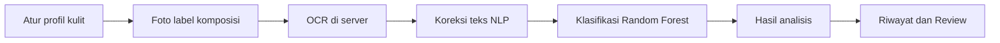
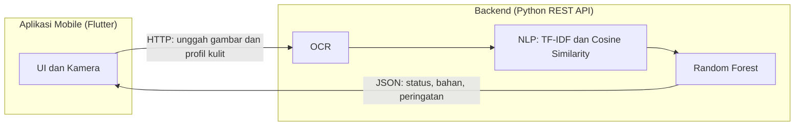
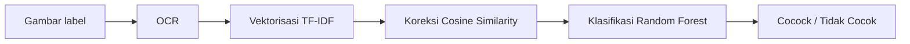

# SkinMatch

**Aplikasi Mobile Analisis Kelayakan Kosmetik Berbasis OCR dan Random Forest untuk Personalisasi Profil Kulit**

Proyek Project Based Learning (PBL) Semester 5.
Program Studi Sarjana Terapan Teknik Informatika, Jurusan Teknologi Informasi, Politeknik Negeri Malang. Kelas TI-3E, Kelompok 2.

Mata kuliah terintegrasi: Pemrograman Mobile, Pembelajaran Mesin, dan Penjaminan Mutu Perangkat Lunak.

---

## Daftar Isi

1. [Deskripsi Proyek](#deskripsi-proyek)
2. [Fitur](#fitur)
3. [Arsitektur Sistem](#arsitektur-sistem)
4. [Machine Learning dan NLP](#machine-learning-dan-nlp)
5. [Dataset](#dataset)
6. [Teknologi](#teknologi)
7. [Ruang Lingkup dan Batasan](#ruang-lingkup-dan-batasan)
8. [Istilah Domain](#istilah-domain)
9. [Pengujian](#pengujian)
10. [Menjalankan Aplikasi](#menjalankan-aplikasi)
11. [Unduh Aplikasi](#unduh-aplikasi)
12. [Struktur Repository](#struktur-repository)
13. [Jadwal dan Milestone](#jadwal-dan-milestone)
14. [Anggota Kelompok](#anggota-kelompok)

---

## Deskripsi Proyek

Ketidaktahuan konsumen terhadap daftar bahan (_ingredients_) pada produk skincare sering memicu iritasi dan _breakout_. Daftar komposisi umumnya ditulis dengan standar penamaan INCI (_International Nomenclature of Cosmetic Ingredients_) yang sulit dipahami orang awam. Akibatnya, pengguna dengan kulit berminyak, sensitif, atau kering dapat tanpa sadar memakai produk yang mengandung bahan komedogenik atau iritan kuat.

SkinMatch adalah aplikasi mobile yang membantu pengguna memprediksi kelayakan produk kosmetik berdasarkan profil kulit mereka. Pengguna memotret daftar komposisi pada kemasan, lalu sistem:

1. Mengekstrak teks komposisi dengan OCR di sisi server.
2. Memperbaiki teks hasil OCR yang salah eja dengan NLP (TF-IDF dan Cosine Similarity).
3. Mengklasifikasikan kecocokan produk terhadap tipe kulit pengguna dengan Random Forest.

Hasil analisis berupa status kecocokan, daftar bahan, peringatan bahan berisiko, dan deskripsi tiap bahan. Target waktu proses dari foto hingga hasil tampil adalah **di bawah 5 detik** pada koneksi internet normal.

> **Catatan:** SkinMatch bukan alat diagnosis medis. Hasil analisis hanya bersifat informatif dan tidak menggantikan konsultasi dengan dokter kulit.

### Tujuan

Mengembangkan aplikasi mobile cerdas yang mampu mengekstrak daftar komposisi pada kemasan produk perawatan kulit secara otomatis, lalu menganalisis tingkat kecocokan dan keamanannya terhadap profil kulit pengguna.

### Alur Penggunaan



---

## Fitur

### 1. Autentikasi (Login)

Pengguna masuk dengan email dan password. Akses ditolak untuk kredensial yang salah, dengan validasi input dan penanganan koneksi gagal.

### 2. Manajemen Profil Kulit

Pengguna menyimpan dan memperbarui tipe kulit (normal, kering, berminyak, sensitif) yang menjadi dasar analisis.

### 3. Pemindai Komposisi (Scan / OCR)

- Mengambil foto label langsung dari kamera atau memilih gambar dari galeri
- Mengunggah gambar ke server melalui REST API
- Mengekstrak teks daftar bahan dengan OCR di sisi backend
- Menampilkan pesan "ulangi foto" bila gambar terlalu buram atau bukan label komposisi

### 4. Klasifikasi Kecocokan Bahan (Fitur ML)

- Membersihkan dan menstandarisasi teks OCR dengan NLP
- Mencocokkan bahan dengan dataset referensi
- Menentukan status kecocokan: **Aman**, **Berisiko**, atau **Sangat Tidak Dianjurkan**
- Menampilkan daftar bahan, peringatan bahan pemicu, dan deskripsi fungsi tiap bahan
- Menandai bahan yang tidak dikenali tanpa menggagalkan seluruh analisis
- Mendeteksi interaksi bahan berbahaya, misalnya AHA/BHA bertemu Retinol pada kulit sensitif

### 5. Riwayat Analisis

Setiap hasil analisis tersimpan otomatis, diurutkan dari yang terbaru, dapat dibuka kembali tanpa pemindaian ulang, dan terisolasi antar pengguna.

### 6. Review Riwayat

Pengguna dapat memberi review pada tiap entri riwayat berupa pilihan **Cocok / Tidak Cocok** dan komentar opsional (maksimal 500 karakter).

### Status Pengembangan

| Fitur                           | Status  |
| ------------------------------- | ------- |
| Autentikasi (Login)             | _(isi)_ |
| Manajemen Profil Kulit          | _(isi)_ |
| Pemindai Komposisi (Scan / OCR) | _(isi)_ |
| Klasifikasi Kecocokan Bahan     | _(isi)_ |
| Riwayat Analisis                | _(isi)_ |
| Review Riwayat                  | _(isi)_ |

---

## Arsitektur Sistem

SkinMatch memakai arsitektur **Client-Server**. Aplikasi mobile hanya menangani antarmuka dan pengambilan gambar, sedangkan beban komputasi berat (OCR, NLP, dan inferensi model) dijalankan di backend agar aplikasi tetap ringan dan responsif.



---

## Machine Learning dan NLP

### Pipeline Pemrosesan



| Tahap          | Metode                               | Fungsi                                                                                             |
| -------------- | ------------------------------------ | -------------------------------------------------------------------------------------------------- |
| Ekstraksi teks | OCR di server (misalnya PyTesseract) | Menghasilkan teks mentah dari gambar label                                                         |
| Vektorisasi    | TF-IDF (Scikit-learn)                | Memecah teks menjadi token lalu mengubahnya menjadi vektor                                         |
| Koreksi ejaan  | Cosine Similarity                    | Mengoreksi kata salah eja ke nama bahan valid bila kemiripan melewati ambang batas (contoh: > 85%) |
| Klasifikasi    | Random Forest Classifier             | Menentukan status kecocokan berdasarkan tipe kulit dan daftar bahan                                |

### Persiapan Data

1. **Data cleaning:** memilih kolom relevan dan menangani _missing values_.
2. **Normalisasi teks:** menghapus tanda baca, angka, dan simbol dengan RegEx, serta _case folding_.
3. **Feature encoding:** mengubah tipe kulit dan daftar komposisi menjadi representasi numerik.
4. **Pelabelan heuristik:** dataset Kaggle tidak memiliki kolom target kecocokan, sehingga label dibuat otomatis dengan kamus bahan pantangan per tipe kulit (kering, berminyak, sensitif, normal) berdasarkan literatur dermatologi. Produk dengan bahan pantangan diberi label `0` (berisiko), sedangkan produk tanpa bahan pantangan diberi label `1` (aman).

### Evaluasi

| Aspek             | Metode                                                                                       |
| ----------------- | -------------------------------------------------------------------------------------------- |
| Model klasifikasi | Train-test split (contoh 80:20), Confusion Matrix, Accuracy, Precision, Recall, F1-Score     |
| Generalisasi      | K-Fold Cross Validation untuk mencegah overfitting                                           |
| Koreksi NLP       | Uji threshold Cosine Similarity (80%, 85%, 90%) dengan 50 kata salah eja yang sengaja dibuat |

Precision dan Recall menjadi perhatian utama karena kesalahan menilai produk berbahaya sebagai "Aman" berdampak langsung pada kesehatan kulit pengguna.

### Deployment Model

Model Random Forest dan matriks fitur TF-IDF diekspor ke format `.pkl` atau `.joblib`, diintegrasikan ke backend Python (FastAPI atau Flask), lalu di-_deploy_ ke layanan cloud. Aplikasi mobile mengakses endpoint API terpusat dan menerima respons JSON.

---

## Dataset

| Sumber                                         | Isi                                                                                                                              | Kegunaan                    |
| ---------------------------------------------- | -------------------------------------------------------------------------------------------------------------------------------- | --------------------------- |
| Kaggle, _SkinSAFE Skincare Products (50,000+)_ | Data produk dan daftar bahan INCI (`product_name`, `brand`, `usage_type`, `category`, `ingredients`, `image_url`, `product_url`) | Melatih model Random Forest |

Pengelolaan data dipusatkan di sisi server sehingga tidak membebani penyimpanan perangkat pengguna.

---

## Teknologi

| Teknologi                      | Kegunaan                                          |
| ------------------------------ | ------------------------------------------------- |
| Flutter dan Dart               | Pengembangan aplikasi mobile (Android)            |
| Python                         | Bahasa pemrograman backend                        |
| FastAPI atau Flask             | REST API backend                                  |
| PyTesseract (atau OCR sejenis) | Ekstraksi teks dari gambar label                  |
| Scikit-learn                   | TF-IDF, Random Forest, dan evaluasi model         |
| Pandas dan RegEx               | Pra-pemrosesan data                               |
| Postman                        | Pengujian API                                     |
| Figma                          | Desain UI/UX dan prototype                        |
| Git dan GitHub                 | Version control, kolaborasi, dan pelacakan defect |

---

## Ruang Lingkup dan Batasan

**Dikerjakan**

- Antarmuka aplikasi mobile dengan Flutter
- Backend API Python untuk OCR di sisi server
- NLP dan model klasifikasi Machine Learning berbasis dataset Kaggle

**Tidak dikerjakan**

- Fitur e-commerce dan konsultasi langsung dengan dokter kulit
- Integrasi API database kosmetik eksternal berskala global
- Diagnosis medis klinis untuk penyakit kulit atau kondisi dermatologis berat

**Asumsi dan batasan**

- Pengguna memakai ponsel dengan koneksi internet stabil.
- Foto label cukup jelas dan terang untuk dibaca OCR.
- Analisis terbatas pada bahan yang terdaftar di dataset SkinSAFE.
- OCR dioptimalkan untuk standar INCI yang umumnya berbahasa Inggris.

**Kriteria keberhasilan**

- Aplikasi dapat mengunggah gambar dan menerima respons server tanpa error.
- Modul OCR mengekstrak teks dengan akurasi cukup untuk diproses modul NLP.
- Model memutuskan status keamanan produk sesuai profil kulit pengguna.
- Proses dari foto hingga hasil tampil selesai dalam waktu di bawah 5 detik pada koneksi normal.

---

## Istilah Domain

| Istilah             | Definisi                                                                                                             |
| ------------------- | -------------------------------------------------------------------------------------------------------------------- |
| INCI                | _International Nomenclature of Cosmetic Ingredients_, standar internasional penamaan bahan kosmetik.                 |
| Tipe Kulit          | Profil kulit pengguna sebagai acuan analisis: normal, kering, berminyak, atau sensitif.                              |
| Status Kecocokan    | Hasil klasifikasi produk: Aman, Berisiko, atau Sangat Tidak Dianjurkan.                                              |
| Bahan Pantangan     | Bahan yang berisiko bagi tipe kulit tertentu; menjadi dasar pelabelan heuristik dan acuan expected result pengujian. |
| Threshold Kemiripan | Ambang batas Cosine Similarity untuk mengoreksi kata hasil OCR ke nama bahan valid.                                  |
| Riwayat             | Catatan hasil analisis yang tersimpan otomatis dan dapat dibuka kembali tanpa pemindaian ulang.                      |

---

## Pengujian

Pengujian mengikuti alur **Requirement → Plan → Scenario → Case → Evidence**. Dokumen lengkap tersedia pada _Laporan Tugas 3: Test Plan, Test Scenario, Test Case, dan Requirement Traceability_ (mata kuliah Penjaminan Mutu Perangkat Lunak). Kolom hasil aktual, status PASS/FAIL, dan bukti diisi pada tahap eksekusi.

### Requirement yang Diuji

| ID     | Fitur                 | Deskripsi                                                                                       | Prioritas |
| ------ | --------------------- | ----------------------------------------------------------------------------------------------- | --------- |
| FR-01  | Login                 | Masuk dengan email dan password; akses ditolak untuk kredensial salah                           | High      |
| FR-02  | Profil Kulit          | Menyimpan dan memperbarui tipe kulit sebagai dasar analisis                                     | High      |
| FR-03  | Scan / OCR            | Memotret atau memilih gambar label, mengunggah ke server, dan mengekstrak teks bahan            | Critical  |
| FR-04  | Klasifikasi Kecocokan | Membersihkan teks OCR dan mengklasifikasikan kecocokan beserta bahan, peringatan, dan deskripsi | Critical  |
| FR-05  | Riwayat Klasifikasi   | Hasil analisis tersimpan otomatis dan dapat dibuka kembali                                      | Medium    |
| FR-06  | Review Riwayat        | Review Cocok / Tidak Cocok dengan komentar pada tiap entri riwayat                              | Medium    |
| NFR-01 | Kinerja               | Foto hingga hasil tampil dalam ≤ 5 detik pada koneksi normal                                    | High      |

### Strategi Pengujian

| Level / Jenis              | Pendekatan                                                                      | Alat                              |
| -------------------------- | ------------------------------------------------------------------------------- | --------------------------------- |
| Functional (Black-Box)     | Validasi input, pesan error, navigasi, dan penyimpanan data di aplikasi Flutter | Perangkat Android, emulator       |
| Integration (Mobile ↔ API) | Format payload, struktur JSON, kode status HTTP, dan penanganan error jaringan  | Postman, log server               |
| OCR Reliability            | Gambar tidak ideal: redup, miring, teks kecil, melengkung                       | Set gambar uji L-01 s.d. L-05     |
| ML dan NLP Evaluation      | Confusion Matrix, Accuracy, Precision, Recall, F1-Score, dan uji threshold      | Scikit-learn, notebook evaluasi   |
| System                     | Alur end-to-end dari login hingga review                                        | Perangkat Android, server staging |
| Performance                | Waktu respons API dan end-to-end terhadap target ≤ 5 detik                      | Postman, stopwatch                |
| Acceptance (UAT)           | Calon pengguna (usulan 3–5 orang) menjalankan alur utama                        | Formulir umpan balik              |

### Data Uji

| Kode               | Deskripsi                                              |
| ------------------ | ------------------------------------------------------ |
| qa.user1           | `qa.user1@skinmatch.test` / `Pass1234`                 |
| qa.user2           | `qa.user2@skinmatch.test` / `Pass5678` (tanpa riwayat) |
| qa.user3, qa.user4 | Akun baru tanpa profil kulit dan tanpa riwayat         |
| L-01               | Foto label jelas, terang, tegak lurus                  |
| L-02               | Foto label dalam ruangan redup tanpa flash             |
| L-03               | Foto label dari sudut miring ± 30°                     |
| L-04               | Foto label dengan huruf sangat kecil                   |
| L-05               | Foto label pada botol silinder (permukaan melengkung)  |

### Test Case

Total **38 test case** dari **25 test scenario**. Prioritas: Critical 4, High 19, Medium 14, Low 1.

#### FR-01 Login

| ID           | Skenario                                         | Expected Result                                                                                  | Prioritas |
| ------------ | ------------------------------------------------ | ------------------------------------------------------------------------------------------------ | --------- |
| TC-LOGIN-001 | Login dengan kredensial valid                    | API merespons HTTP 200; pengguna diarahkan ke Beranda                                            | High      |
| TC-LOGIN-002 | Login dengan password salah                      | HTTP 401; pesan "Email atau password salah"; tetap di halaman Login                              | High      |
| TC-LOGIN-003 | Login dengan email kosong                        | Pesan "Email wajib diisi"; tidak ada request ke server                                           | Medium    |
| TC-LOGIN-004 | Login dengan email tanpa "@"                     | Pesan "Format email tidak valid"; tidak ada request ke server                                    | Medium    |
| TC-LOGIN-005 | Login saat koneksi internet gagal (mode pesawat) | Pesan gagal terhubung ke server tampil; aplikasi tidak crash; tombol Login dapat ditekan kembali | High      |

#### FR-02 Profil Kulit

| ID          | Skenario                                        | Expected Result                                                                 | Prioritas |
| ----------- | ----------------------------------------------- | ------------------------------------------------------------------------------- | --------- |
| TC-PROF-001 | Menyimpan tipe kulit "Berminyak" pada akun baru | Pesan "Profil berhasil disimpan"; tipe kulit tetap setelah login ulang          | High      |
| TC-PROF-002 | Mengubah tipe kulit dari Berminyak ke Sensitif  | Pesan sukses; profil menampilkan "Sensitif" dan "Berminyak" tidak lagi terpilih | High      |
| TC-PROF-003 | Menyimpan profil tanpa memilih tipe kulit       | Pesan "Pilih tipe kulit Anda"; data tidak tersimpan                             | Medium    |

#### FR-03 Scan / OCR

| ID         | Skenario                                    | Expected Result                                                                                                          | Prioritas |
| ---------- | ------------------------------------------- | ------------------------------------------------------------------------------------------------------------------------ | --------- |
| TC-OCR-001 | Foto langsung label L-01 (jelas dan terang) | Unggah HTTP 200; teks OCR memuat minimal 4 dari 5 bahan (≥ 80%); lanjut ke analisis                                      | Critical  |
| TC-OCR-002 | Memilih gambar L-01 dari galeri             | Unggah HTTP 200; teks OCR memuat ≥ 80% bahan; lanjut ke analisis                                                         | High      |
| TC-OCR-003 | Foto label L-02 (ruangan redup)             | ≥ 70% bahan terbaca → lanjut analisis; < 70% → pesan "Gambar kurang jelas, silakan ulangi pengambilan foto"; tidak crash | High      |
| TC-OCR-004 | Foto label L-03 (sudut miring ± 30°)        | Aturan sama dengan TC-OCR-003                                                                                            | High      |
| TC-OCR-005 | Foto label L-04 (huruf sangat kecil)        | Aturan sama dengan TC-OCR-003                                                                                            | Medium    |
| TC-OCR-006 | Foto label L-05 (botol silinder)            | Aturan sama dengan TC-OCR-003                                                                                            | Medium    |
| TC-OCR-007 | Izin kamera ditolak                         | Pesan "Izin kamera diperlukan untuk memindai label" dengan opsi Pengaturan atau galeri; tidak crash                      | High      |
| TC-OCR-008 | Foto objek tanpa teks (dinding polos)       | HTTP 422; pesan "Teks komposisi tidak ditemukan"; tidak ada entri riwayat baru                                           | High      |

#### FR-04 Klasifikasi Kecocokan

| ID         | Skenario                                                                          | Expected Result                                                                                      | Prioritas |
| ---------- | --------------------------------------------------------------------------------- | ---------------------------------------------------------------------------------------------------- | --------- |
| TC-CLS-001 | Kulit Kering; semua bahan aman (Aqua, Glycerin, Squalane, Ceramide NP, Panthenol) | Status "Aman"; lima bahan tampil di daftar aman; tanpa peringatan                                    | Critical  |
| TC-CLS-002 | Kulit Sensitif; mengandung Alcohol Denat., Parfum, Limonene                       | Status "Berisiko"; peringatan menyebut Alcohol Denat. dan Parfum; Glycerin tampil sebagai bahan aman | Critical  |
| TC-CLS-003 | Kulit Sensitif; Glycolic Acid + Salicylic Acid + Retinol                          | Status "Sangat Tidak Dianjurkan"; peringatan interaksi AHA/BHA dengan Retinol tampil                 | Critical  |
| TC-CLS-004 | Koreksi typo OCR (Glycerln, Niacinamlde) pada threshold 85%                       | Dikoreksi menjadi "Glycerin" dan "Niacinamide"; tidak ada bahan salah dikoreksi                      | High      |
| TC-CLS-005 | Produk sama dianalisis pada profil Berminyak lalu Kering                          | Berminyak → "Berisiko" (Isopropyl Myristate, Coconut Oil); Kering → "Aman"; hasil berbeda            | High      |
| TC-CLS-006 | Bahan tidak dikenal (Xyzzylene Blorphate)                                         | Ditandai "Tidak dikenali"; bahan lain tetap tampil; tidak ada HTTP 5xx                               | Medium    |
| TC-CLS-007 | Mengetuk bahan "Glycerin" pada layar hasil                                        | Deskripsi fungsi dari dataset cosmetic-ingredients tampil dan tidak kosong                           | Medium    |
| TC-CLS-008 | Analisis saat profil kulit belum diisi                                            | Pengguna diminta melengkapi profil dahulu; analisis tidak dijalankan                                 | High      |

#### NFR-01 Kinerja

| ID          | Skenario                                                           | Expected Result                                              | Prioritas |
| ----------- | ------------------------------------------------------------------ | ------------------------------------------------------------ | --------- |
| TC-PERF-001 | Waktu respons API untuk gambar L-01 (5 kali pengulangan)           | Rata-rata ≤ 5000 ms; struktur JSON valid pada setiap respons | High      |
| TC-PERF-002 | Waktu end-to-end dari tombol Analisis hingga hasil tampil (5 kali) | Rata-rata ≤ 5 detik                                          | High      |

#### FR-05 Riwayat Klasifikasi

| ID          | Skenario                                      | Expected Result                                                                           | Prioritas |
| ----------- | --------------------------------------------- | ----------------------------------------------------------------------------------------- | --------- |
| TC-HIST-001 | Riwayat tersimpan otomatis setelah pemindaian | Satu entri baru berisi tanggal-waktu dan status kecocokan yang sama dengan hasil analisis | High      |
| TC-HIST-002 | Daftar riwayat dengan 3 entri                 | Entri tampil dari yang terbaru: E3, E2, E1                                                | Medium    |
| TC-HIST-003 | Membuka detail entri riwayat                  | Detail sama dengan hasil saat pemindaian; tidak ada request OCR/klasifikasi baru          | High      |
| TC-HIST-004 | Riwayat kosong pada akun baru                 | Pesan "Belum ada riwayat pemindaian"; tidak ada error                                     | Medium    |
| TC-HIST-005 | Isolasi riwayat antar pengguna                | qa.user2 tidak melihat entri milik qa.user1                                               | High      |
| TC-HIST-006 | Riwayat setelah logout dan login ulang        | Seluruh entri masih tampil utuh                                                           | Medium    |

#### FR-06 Review Riwayat

| ID         | Skenario                                                         | Expected Result                                                                                                | Prioritas |
| ---------- | ---------------------------------------------------------------- | -------------------------------------------------------------------------------------------------------------- | --------- |
| TC-REV-001 | Review "Cocok" dengan komentar                                   | Pesan "Review berhasil disimpan"; detail menampilkan pilihan dan komentar persis sama                          | High      |
| TC-REV-002 | Review "Tidak Cocok" tanpa komentar                              | Review tersimpan (komentar opsional)                                                                           | Medium    |
| TC-REV-003 | Menyimpan komentar tanpa memilih Cocok/Tidak Cocok               | Pesan "Pilih Cocok atau Tidak Cocok"; review tidak tersimpan                                                   | Medium    |
| TC-REV-004 | Komentar 501 karakter                                            | Ditolak dengan pesan "Komentar maksimal 500 karakter" atau input dihentikan di karakter ke-500; tanpa HTTP 5xx | Low       |
| TC-REV-005 | Komentar berisi karakter khusus (`<script>`, tanda kutip, emoji) | Komentar ditampilkan apa adanya; tidak ada script berjalan; tidak crash                                        | Medium    |
| TC-REV-006 | Review terikat pada entri yang benar                             | Entri yang belum direview tidak memuat review entri lain; review lama tetap utuh                               | Medium    |

### Requirement Traceability Matrix (RTM)

| Req ID | Fitur                 | Prioritas | Test Case             | Jumlah TC | Status Eksekusi  |
| ------ | --------------------- | --------- | --------------------- | --------- | ---------------- |
| FR-01  | Login                 | High      | TC-LOGIN-001 s.d. 005 | 5         | Belum dieksekusi |
| FR-02  | Profil Kulit          | High      | TC-PROF-001 s.d. 003  | 3         | Belum dieksekusi |
| FR-03  | Scan / OCR            | Critical  | TC-OCR-001 s.d. 008   | 8         | Belum dieksekusi |
| FR-04  | Klasifikasi Kecocokan | Critical  | TC-CLS-001 s.d. 008   | 8         | Belum dieksekusi |
| FR-05  | Riwayat Klasifikasi   | Medium    | TC-HIST-001 s.d. 006  | 6         | Belum dieksekusi |
| FR-06  | Review Riwayat        | Medium    | TC-REV-001 s.d. 006   | 6         | Belum dieksekusi |
| NFR-01 | Kinerja               | High      | TC-PERF-001 s.d. 002  | 2         | Belum dieksekusi |

### Kriteria Masuk dan Keluar

**Entry criteria**

- Build aplikasi (APK) tersedia dan dapat dipasang
- Backend staging aktif dan endpoint dapat diakses
- Requirement disepakati dan test case sudah direview
- Akun uji dan data uji (L-01 s.d. L-05) tersedia

**Exit criteria**

- Seluruh test case prioritas Critical dan High telah dieksekusi
- Tidak ada defect Critical/High yang masih open
- Minimal 90% test case berstatus PASS
- Setiap requirement pada RTM memiliki minimal satu test case yang dieksekusi
- Target waktu ≤ 5 detik tercapai dan metrik ML dilaporkan
- Hasil dan bukti pengujian terdokumentasi

---

## Menjalankan Aplikasi

> Perintah di bawah adalah kerangka. Sesuaikan nama folder, URL, dan perintah dengan kondisi repository.

### Prasyarat

- Flutter SDK dan Dart ([panduan instalasi](https://docs.flutter.dev/get-started/install))
- Android Studio atau Visual Studio Code dengan ekstensi Flutter
- Emulator Android atau perangkat Android fisik dengan USB debugging aktif
- Python 3.x untuk backend
- Git

### Menjalankan Backend

```bash
git clone <URL-REPOSITORY>
cd <NAMA-REPOSITORY>/<FOLDER-BACKEND>
python -m venv venv
# Aktifkan virtual environment, lalu:
pip install -r requirements.txt
# Jalankan server (sesuaikan dengan framework yang dipakai)
<PERINTAH-MENJALANKAN-SERVER>
```

Pastikan server dapat diakses oleh aplikasi mobile, lalu atur alamat API pada konfigurasi aplikasi: `<LOKASI-KONFIGURASI-BASE-URL>`.

### Menjalankan Aplikasi Mobile

```bash
cd <NAMA-REPOSITORY>/<FOLDER-FLUTTER>
flutter pub get
flutter devices
flutter run -d <id-perangkat>
```

Jika terdapat kendala pada lingkungan pengembangan, jalankan `flutter doctor` untuk memeriksa konfigurasi.

### Menjalankan pada Perangkat Fisik

1. Aktifkan Developer options pada perangkat Android (Settings, About phone, ketuk Build number sebanyak tujuh kali).
2. Aktifkan USB debugging.
3. Hubungkan perangkat ke komputer dengan kabel USB dan izinkan debugging.
4. Jalankan `flutter run`.

### Build APK

```bash
cd <FOLDER-FLUTTER>
flutter build apk --release
```

Berkas hasil build berada di `build/app/outputs/flutter-apk/app-release.apk`.

---

## Struktur Repository

```text
<NAMA-REPOSITORY>/
├── README.md
├── design/                 Prototype dan mockup antarmuka (Figma)
├── <FOLDER-BACKEND>/       Backend Python: REST API, OCR, NLP, model
└── <FOLDER-FLUTTER>/       Source code aplikasi Flutter
    ├── android/
    ├── lib/
    ├── test/
    └── pubspec.yaml
```

### Struktur `lib/` (Flutter)

Proyek mengikuti pola _feature-first_: setiap fitur punya folder `presentation/` untuk layar dan `widgets/` untuk komponen khusus fitur tersebut.

```text
lib/
├── core/                         Aturan desain global (wajib dibaca sebelum styling)
│   ├── constants/                app_colors.dart, app_typography.dart
│   ├── theme/                    app_theme.dart (konfigurasi ThemeData global)
│   └── routing/                  app_router.dart
│
├── features/                     Modul spesifik aplikasi
│   ├── auth/                     Layar Login dan Register
│   │   ├── presentation/         login_screen.dart
│   │   └── widgets/              auth_text_field.dart
│   ├── profile/                  Onboarding dan formulir tipe kulit
│   │   ├── presentation/         skin_profile_screen.dart
│   │   └── widgets/              skin_type_card.dart (radio button custom)
│   ├── scanner/                  Kamera dan pemindai OCR
│   │   ├── presentation/         camera_screen.dart
│   │   └── widgets/              camera_overlay_painter.dart
│   ├── analysis/                 Hasil klasifikasi ingredients (merah/hijau)
│   │   ├── presentation/         result_screen.dart
│   │   └── widgets/              ingredient_status_card.dart, circular_score.dart
│   └── history/                  Dasbor dan riwayat pemindaian
│       ├── presentation/         history_screen.dart
│       └── widgets/              history_list_item.dart
│
└── shared/                       Komponen UI reusable (dipakai di lebih dari satu fitur)
    └── widgets/                  primary_button.dart, custom_app_bar.dart, status_badge.dart
```

| Folder              | Peran                                                |
| ------------------- | ---------------------------------------------------- |
| `core/`             | Warna, tipografi, tema, dan routing global           |
| `features/auth`     | Login dan registrasi                                 |
| `features/profile`  | Pengisian dan pembaruan tipe kulit                   |
| `features/scanner`  | Kamera dan unggah gambar label                       |
| `features/analysis` | Tampilan hasil klasifikasi dan detail bahan          |
| `features/history`  | Daftar riwayat, detail, dan review                   |
| `shared/`           | Tombol, app bar, dan badge yang dipakai lintas fitur |

---

## Anggota Kelompok

Kelas TI-3E, Kelompok 2
Program Studi Sarjana Terapan Teknik Informatika, Politeknik Negeri Malang

| No. | Nama                       | NIM          |
| --- | -------------------------- | ------------ |
| 1   | Risky Adi Prasetya         | 244107020153 |
| 2   | Hafif Nurrahmad            | 244107020176 |
| 3   | Muhammad Rizky Firdiansyah | 244107020013 |
| 4   | Raihan Daffa Izzuddin      | 244107020113 |
| 5   | Radita Yoga Anugrah        | 254107023099 |

### Dosen Pengampu

| Mata Kuliah                     | Dosen                             |
| ------------------------------- | --------------------------------- |
| Pemrograman Mobile              | Agung Nugroho P., S.T., M.T.      |
| Pembelajaran Mesin              | Rachmad Imam T., S.Kom., M.Kom    |
| Penjaminan Mutu Perangkat Lunak | Titis Octary Satrio, S.ST., M.MT. |
